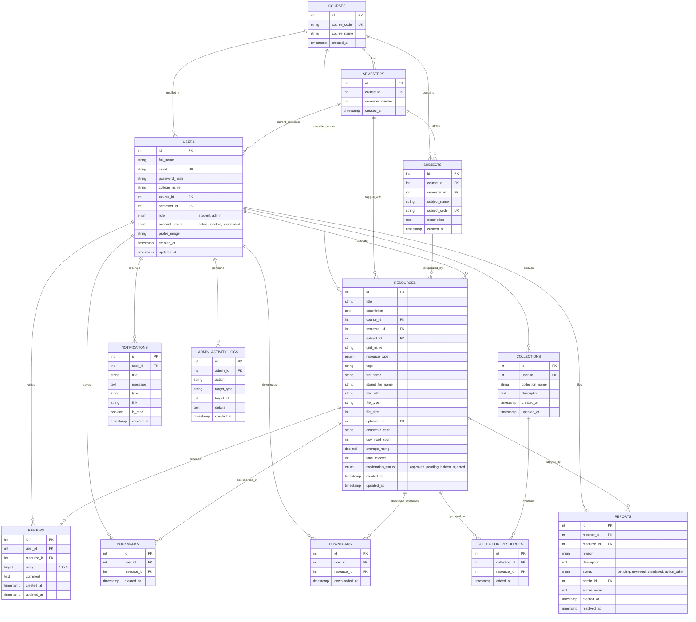

# ShelfShare - Database Entity-Relationship Diagram (ERD)

This document details the relational schema, constraints, keys, and entity relationships for the **ShelfShare** student academic resource sharing platform. The database is hosted on MySQL Server 9.7 (`shelfshare_db`) using the InnoDB storage engine.

---

## 1. Visual Entity Relationship Diagram (Mermaid)

---

## 2. Relational Schema Data Dictionary

### Table 1: `courses`
Stores academic programs/degrees offered in colleges (e.g. Master of Computer Applications, Bachelor of Computer Applications).
- `id` (INT, PK, AUTO_INCREMENT)
- `course_code` (VARCHAR(30), UNIQUE, NOT NULL): e.g., 'MCA', 'BCA', 'BTECH-CS'.
- `course_name` (VARCHAR(150), NOT NULL): e.g., 'Master of Computer Applications'.
- `created_at` (TIMESTAMP, DEFAULT CURRENT_TIMESTAMP).

### Table 2: `semesters`
Stores semester levels linked to each course.
- `id` (INT, PK, AUTO_INCREMENT)
- `course_id` (INT, FK -> `courses.id`, ON DELETE CASCADE)
- `semester_number` (INT, NOT NULL)
- `created_at` (TIMESTAMP)
- **Constraint**: `uq_course_semester UNIQUE(course_id, semester_number)`

### Table 3: `subjects`
Curriculum subjects mapped directly to course and semester.
- `id` (INT, PK, AUTO_INCREMENT)
- `course_id` (INT, FK -> `courses.id`, ON DELETE CASCADE)
- `semester_id` (INT, FK -> `semesters.id`, ON DELETE CASCADE)
- `subject_name` (VARCHAR(150), NOT NULL)
- `subject_code` (VARCHAR(50), UNIQUE, NOT NULL): e.g., 'MCA101'
- `description` (TEXT, NULL)
- `created_at` (TIMESTAMP)
- **Index**: `idx_subjects_course_sem (course_id, semester_id)`

### Table 4: `users`
Student and administrator accounts.
- `id` (INT, PK, AUTO_INCREMENT)
- `full_name` (VARCHAR(120), NOT NULL)
- `email` (VARCHAR(150), UNIQUE, NOT NULL)
- `password_hash` (VARCHAR(255), NOT NULL)
- `college_name` (VARCHAR(180), NOT NULL)
- `course_id` (INT, FK -> `courses.id`, ON DELETE SET NULL)
- `semester_id` (INT, FK -> `semesters.id`, ON DELETE SET NULL)
- `role` (ENUM('student', 'admin'), DEFAULT 'student')
- `account_status` (ENUM('active', 'inactive', 'suspended'), DEFAULT 'active')
- `profile_image` (VARCHAR(255), NULL)
- `created_at`, `updated_at` (TIMESTAMP)
- **Indexes**: `idx_users_role (role)`, `idx_users_status (account_status)`

### Table 5: `resources`
Academic documents uploaded by students.
- `id` (INT, PK, AUTO_INCREMENT)
- `title` (VARCHAR(200), NOT NULL)
- `description` (TEXT, NOT NULL)
- `course_id` (INT, FK -> `courses.id`, ON DELETE RESTRICT)
- `semester_id` (INT, FK -> `semesters.id`, ON DELETE RESTRICT)
- `subject_id` (INT, FK -> `subjects.id`, ON DELETE RESTRICT)
- `unit_name` (VARCHAR(120), NULL)
- `resource_type` (ENUM: 'Lecture Notes', 'Handwritten Notes', 'Previous Year Question Papers', 'Assignments', 'Presentations', 'Programming Examples', 'Reference Materials', 'Other')
- `tags` (VARCHAR(255), NULL)
- `file_name` (VARCHAR(255), NOT NULL): Original file name displayed to users.
- `stored_file_name` (VARCHAR(255), NOT NULL): Cryptographically hashed file name on disk.
- `file_path` (VARCHAR(255), NOT NULL): Relative storage path in `backend/uploads/`.
- `file_type` (VARCHAR(20), NOT NULL): MIME/Extension ('pdf', 'docx', 'pptx').
- `file_size` (INT, NOT NULL): Size in bytes.
- `uploader_id` (INT, FK -> `users.id`, ON DELETE CASCADE)
- `academic_year` (VARCHAR(30), NULL)
- `download_count` (INT UNSIGNED, DEFAULT 0)
- `average_rating` (DECIMAL(3,2), DEFAULT 0.00)
- `total_reviews` (INT UNSIGNED, DEFAULT 0)
- `moderation_status` (ENUM('approved', 'pending', 'hidden', 'rejected'), DEFAULT 'approved')
- `created_at`, `updated_at` (TIMESTAMP)
- **Indexes**: `idx_resources_search (course_id, semester_id, subject_id)`, `idx_resources_type (resource_type)`, `idx_resources_moderation (moderation_status)`, `idx_resources_ranking (average_rating, download_count)`

### Table 6: `reviews`
Student ratings (1 to 5 stars) and feedback comments.
- `id` (INT, PK, AUTO_INCREMENT)
- `user_id` (INT, FK -> `users.id`, ON DELETE CASCADE)
- `resource_id` (INT, FK -> `resources.id`, ON DELETE CASCADE)
- `rating` (TINYINT UNSIGNED, NOT NULL, 1 to 5)
- `comment` (TEXT, NOT NULL)
- `created_at`, `updated_at` (TIMESTAMP)
- **Constraint**: `uq_user_resource_review UNIQUE(user_id, resource_id)` (One review per student per document).

### Table 7: `bookmarks`
Saved resources for quick student recall.
- `id` (INT, PK, AUTO_INCREMENT)
- `user_id` (INT, FK -> `users.id`, ON DELETE CASCADE)
- `resource_id` (INT, FK -> `resources.id`, ON DELETE CASCADE)
- `created_at` (TIMESTAMP)
- **Constraint**: `uq_user_resource_bookmark UNIQUE(user_id, resource_id)`

### Table 8: `downloads`
Audit logging of verified document downloads.
- `id` (INT, PK, AUTO_INCREMENT)
- `user_id` (INT, FK -> `users.id`, ON DELETE CASCADE)
- `resource_id` (INT, FK -> `resources.id`, ON DELETE CASCADE)
- `downloaded_at` (TIMESTAMP)
- **Indexes**: `idx_downloads_user`, `idx_downloads_resource`, `idx_downloads_time`

### Table 9: `collections`
Custom user folders (e.g. "Final Exam Prep", "Lab Programs").
- `id` (INT, PK, AUTO_INCREMENT)
- `user_id` (INT, FK -> `users.id`, ON DELETE CASCADE)
- `collection_name` (VARCHAR(120), NOT NULL)
- `description` (TEXT, NULL)
- `created_at`, `updated_at` (TIMESTAMP)

### Table 10: `collection_resources`
Many-to-Many bridge table between collections and resources.
- `id` (INT, PK, AUTO_INCREMENT)
- `collection_id` (INT, FK -> `collections.id`, ON DELETE CASCADE)
- `resource_id` (INT, FK -> `resources.id`, ON DELETE CASCADE)
- `added_at` (TIMESTAMP)
- **Constraint**: `uq_collection_resource UNIQUE(collection_id, resource_id)`

### Table 11: `reports`
User reports flagged on inappropriate, duplicate, or copyright-infringing content.
- `id` (INT, PK, AUTO_INCREMENT)
- `reporter_id` (INT, FK -> `users.id`, ON DELETE CASCADE)
- `resource_id` (INT, FK -> `resources.id`, ON DELETE CASCADE)
- `reason` (ENUM: 'Incorrect content', 'Duplicate material', 'Copyright concern', 'Inappropriate content', 'Broken or corrupted file', 'Other')
- `description` (TEXT, NULL)
- `status` (ENUM('pending', 'reviewed', 'dismissed', 'action_taken'), DEFAULT 'pending')
- `admin_id` (INT, FK -> `users.id`, ON DELETE SET NULL)
- `admin_notes` (TEXT, NULL)
- `created_at`, `resolved_at` (TIMESTAMP)

### Table 12: `notifications`
Real-time user alerts for approvals, reviews, and announcements.
- `id` (INT, PK, AUTO_INCREMENT)
- `user_id` (INT, FK -> `users.id`, ON DELETE CASCADE)
- `title` (VARCHAR(150), NOT NULL)
- `message` (TEXT, NOT NULL)
- `type` (VARCHAR(50), DEFAULT 'general')
- `link` (VARCHAR(255), NULL)
- `is_read` (BOOLEAN, DEFAULT FALSE)
- `created_at` (TIMESTAMP)

### Table 13: `admin_activity_logs`
Immutable administrative audit trail.
- `id` (INT, PK, AUTO_INCREMENT)
- `admin_id` (INT, FK -> `users.id`, ON DELETE CASCADE)
- `action` (VARCHAR(100), NOT NULL)
- `target_type` (VARCHAR(50), NOT NULL)
- `target_id` (INT, NULL)
- `details` (TEXT, NULL)
- `created_at` (TIMESTAMP)
